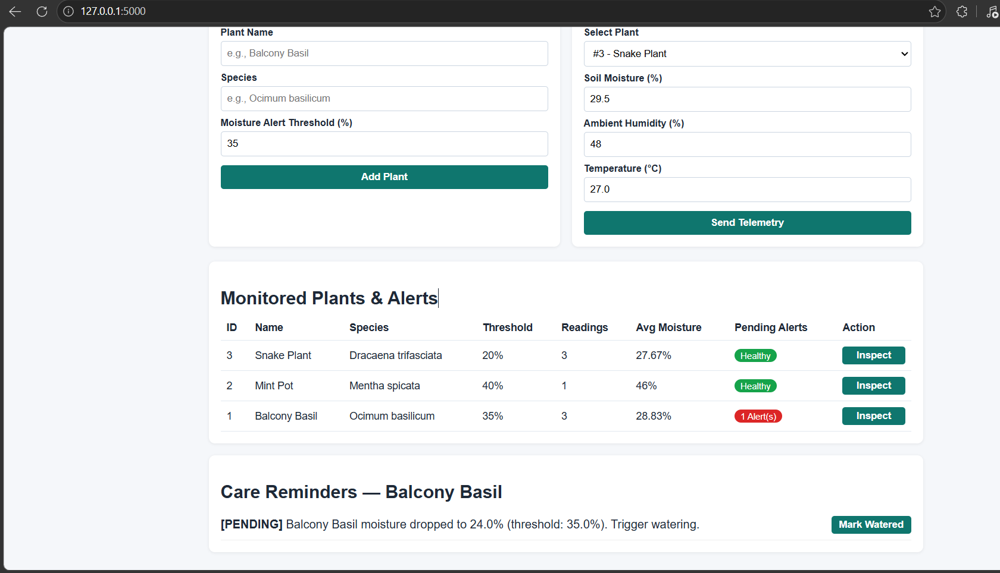
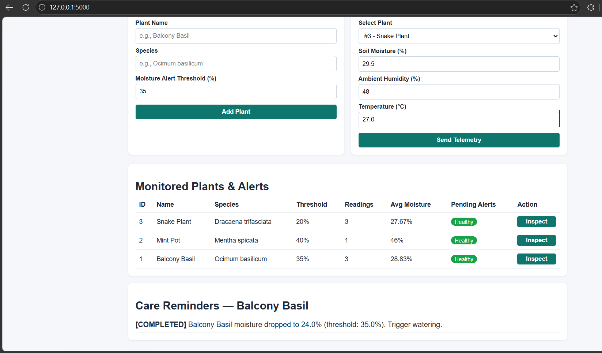

# Web-Enabled IoT Plant Care & Telemetry Collection System

A full-stack Python (Flask) REST API and web dashboard for ingesting plant sensor telemetry (soil moisture, ambient humidity, temperature), storing time-series data in a normalized relational database, and triggering automated watering alerts with duplicate-alert suppression.

## Application Screenshots

**1. Telemetry Dashboard & Registered Plants**


**2. Automated Watering Alert Triggered**


**3. Alert Inspection & Resolution**


## Key Engineering Highlights

- **3NF Relational Database (**`schema_mysql.sql`**):** Normalized MySQL schema (`plants`, `sensor_readings`, `care_reminders`) with foreign key cascades, `CHECK` constraints, and composite indexes on `(plant_id, recorded_at)` and `(plant_id, status)`.
- **Fan-Out Safe SQL Aggregations:** Uses Common Table Expressions (CTEs) in `GET /api/plants` to aggregate child tables independently before joining, preventing row-multiplication bugs in `COUNT()` and `AVG()`.
- **Idempotent Alerting:** Automatically generates a `PENDING` watering reminder when `soil_moisture < moisture_threshold` while blocking duplicate open alerts on repeated low readings.
- **Strict Input Validation & SQL Injection Prevention:** Parameterized queries throughout `db.py`, explicit range/type checks (including Python `bool`-as-`int` guards), and consistent REST status codes (`200`, `201`, `400`, `404`).
- **Automated QA (**`tests/test_api.py`**):** 7 `pytest` integration tests covering CRUD flows, boundary/malformed payloads, `404` handling, duplicate-alert suppression, and SQL summary statistics.

## REST API Endpoints

| Method | Endpoint | Description |
| --- | --- | --- |
| `GET` | `/api/health` | Service and active database backend health check |
| `GET` | `/api/plants` | List all monitored plants with reading stats and pending alert counts |
| `POST` | `/api/plants` | Register a new plant with a custom moisture threshold (`0–100`) |
| `POST` | `/api/readings` | Ingest sensor telemetry and evaluate automated watering rules |
| `GET` | `/api/plants/<id>/summary` | Retrieve aggregated statistics, last 10 readings, and reminder history |
| `PUT` | `/api/reminders/<id>` | Update reminder status (`PENDING`, `COMPLETED`, `DISMISSED`) |

## Local Setup & Testing

```bash
python -m venv venv
venv\Scripts\activate
python -m pip install -r requirements.txt

# Run automated test suite (7 tests)
python -m pytest -v

# Start local server (SQLite default; set USE_MYSQL=true for MySQL)
python app.py
```

Open `http://127.0.0.1:5000` in your browser to use the interactive telemetry dashboard.